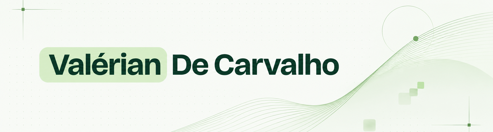
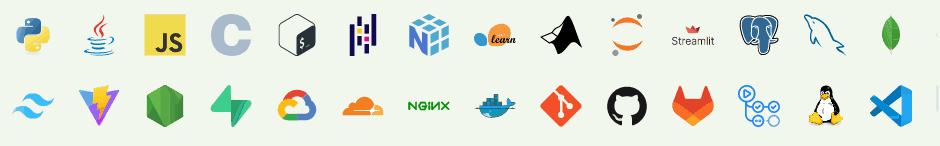

<!-- Technical documentation: docs/overview.md. Generated snake is published on the output branch. -->

<strong>FR</strong> · Français

  <picture>
    <source media="(prefers-color-scheme: dark)" srcset="./assets/brand/banner-dark.png">
    
  </picture>

<strong>À la croisée des données, du logiciel et du monde physique.</strong>

J’aime comprendre comment les systèmes fonctionnent, questionner leurs limites et développer mes propres solutions. Cette curiosité me mène des pipelines de données et du machine learning aux applications web et aux prototypes imprimés en 3D. J’expérimente, je teste et j’améliore mes idées pour en faire des réalisations utiles.

  <a href="https://valeriandecarvalho.com"><picture>
      <source media="(prefers-color-scheme: dark)" srcset="./assets/links/portfolio-dark.svg">
      
    </picture></a>

<strong>RÉSEAUX</strong>

  <a href="https://github.com/valeriandecarvalho"><picture>
      <source media="(prefers-color-scheme: dark)" srcset="./assets/links/social-github-dark.svg">
      
    </picture></a>

  <a href="https://www.linkedin.com/in/valeriandecarvalho/"><picture>
      <source media="(prefers-color-scheme: dark)" srcset="./assets/links/social-linkedin-dark.svg">
      
    </picture></a>

---

### Toolbox

  <picture>
    <source media="(prefers-color-scheme: dark) and (prefers-reduced-motion: reduce)" srcset="./assets/toolbox/marquee-dark-still.png">
    <source media="(prefers-color-scheme: light) and (prefers-reduced-motion: reduce)" srcset="./assets/toolbox/marquee-light-still.png">
    <source media="(prefers-color-scheme: dark)" srcset="./assets/toolbox/marquee-dark.gif">
    
  </picture>

---

### Contributions

  <picture>
    <source media="(prefers-color-scheme: dark)" srcset="https://raw.githubusercontent.com/valeriandecarvalho/valeriandecarvalho/output/github-snake-dark.svg">
    
  </picture>

---

### Contact

Une question, une collaboration ou une idée à discuter ? Choisissez le moyen qui vous convient.

  <a href="mailto:contact@valeriandecarvalho.com"><picture>
      <source media="(prefers-color-scheme: dark)" srcset="./assets/links/contact-fr-email-dark.svg">
      
    </picture></a>

  <a href="https://www.linkedin.com/in/valeriandecarvalho/"><picture>
      <source media="(prefers-color-scheme: dark)" srcset="./assets/links/contact-fr-linkedin-dark.svg">
      
    </picture></a>

E-mail : <a href="mailto:contact@valeriandecarvalho.com">contact@valeriandecarvalho.com</a>

<strong>EN</strong> · English

  <picture>
    <source media="(prefers-color-scheme: dark)" srcset="./assets/brand/banner-dark.png">
    
  </picture>

<strong>Building across data, software and the physical world.</strong>

I like figuring out how systems work, questioning their limits, and building something of my own. That curiosity takes me from data pipelines and machine learning to web applications and 3D-printed prototypes. I experiment, test what works, and refine ideas into useful things.

  <a href="https://valeriandecarvalho.com"><picture>
      <source media="(prefers-color-scheme: dark)" srcset="./assets/links/portfolio-dark.svg">
      
    </picture></a>

<strong>SOCIALS</strong>

  <a href="https://github.com/valeriandecarvalho"><picture>
      <source media="(prefers-color-scheme: dark)" srcset="./assets/links/social-github-dark.svg">
      
    </picture></a>

  <a href="https://www.linkedin.com/in/valeriandecarvalho/"><picture>
      <source media="(prefers-color-scheme: dark)" srcset="./assets/links/social-linkedin-dark.svg">
      
    </picture></a>

---

### Toolbox

  <picture>
    <source media="(prefers-color-scheme: dark) and (prefers-reduced-motion: reduce)" srcset="./assets/toolbox/marquee-dark-still.png">
    <source media="(prefers-color-scheme: light) and (prefers-reduced-motion: reduce)" srcset="./assets/toolbox/marquee-light-still.png">
    <source media="(prefers-color-scheme: dark)" srcset="./assets/toolbox/marquee-dark.gif">
    
  </picture>

---

### Contributions

  <picture>
    <source media="(prefers-color-scheme: dark)" srcset="https://raw.githubusercontent.com/valeriandecarvalho/valeriandecarvalho/output/github-snake-dark.svg">
    
  </picture>

---

### Get in touch

Have a question, collaboration or idea to discuss? Choose the channel that works best for you.

  <a href="mailto:contact@valeriandecarvalho.com"><picture>
      <source media="(prefers-color-scheme: dark)" srcset="./assets/links/contact-en-email-dark.svg">
      
    </picture></a>

  <a href="https://www.linkedin.com/in/valeriandecarvalho/"><picture>
      <source media="(prefers-color-scheme: dark)" srcset="./assets/links/contact-en-linkedin-dark.svg">
      
    </picture></a>

Email: <a href="mailto:contact@valeriandecarvalho.com">contact@valeriandecarvalho.com</a>

