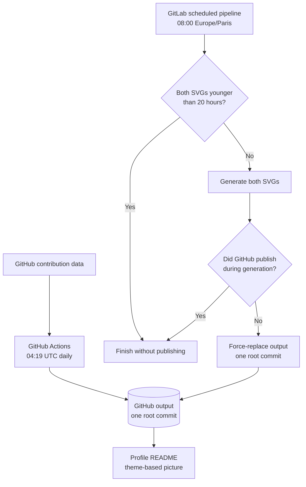

# Architecture · Profile & contribution snake

The GitHub README renders the profile. The `output` branch holds only two generated SVG files; it is not a deployment branch for the README assets.

## Responsibilities

| Component | Role | Source |
| --- | --- | --- |
| `main/README.md` | Public profile with two languages and links | GitHub |
| `main/assets/` | Local graphics and moving toolbox | GitHub |
| `.github/workflows/snake.yml` | Generate both snake SVGs with Platane/snk | GitHub Actions |
| `output` | Public read-only (to visitors) SVG snapshot | GitHub branch |
| `.gitlab-ci.yml` | Push validation and scheduled/manual fallback | GitLab CI |
| `scripts/check-freshness.mjs` | Inspect last commit time for **both** output files | GitLab |
| `scripts/generate-snake.sh` | Run `generate-snake-animation@3` with matching palette | GitLab |
| `scripts/publish.mjs` | Publish **only** to `output` using a parentless commit | GitLab → GitHub API |

## Timing and limitations

- GitHub Actions schedule: `19 4 * * *` in UTC (05:19 in Paris winter time, 06:19 summer time; actual start can be delayed).
- GitLab fallback schedule must be configured **in GitLab UI**: `0 8 * * *` with `Europe/Paris` timezone; committing `.gitlab-ci.yml` does not create a schedule.
- Freshness threshold: `SNAKE_MAX_AGE_HOURS=20`. A successful GitLab job may correctly **skip** publishing if the existing SVGs are recent.
- A **manual** GitLab pipeline from the UI on `main` forces regeneration. Scheduled pipelines do not.
- GitHub Actions may be blocked by account restrictions. GitLab uses a separate runner but still needs valid GitHub API access.
- The GIF toolbox is **not generated by the daily snake jobs**. It is created only when the technical logo inventory changes.

## Permissions and security

- GitHub Actions uses its repository-scoped `GITHUB_TOKEN` with `contents: write`.
- GitLab uses a **different** fine-grained GitHub token, stored in GitLab CI/CD variable `GITHUB_TOKEN`, with **Contents: read/write** for the profile repository only.
- The fallback code rejects updates to any branch other than `output`; it never writes to `main`.
- Avoid displaying secrets in logs, screenshots, docs or git commits.
